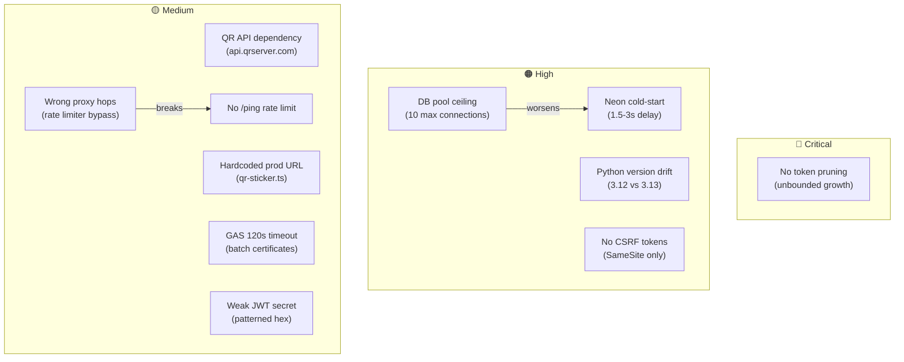

# 🔴 CSEC ASTU Platform — Failure Point Analysis Report

**Date:** October 18, 2026  
**Scope:** Full-stack audit across Backend, Frontend, Telegram Bot, GAS Integration, CI/CD, and Infrastructure  
**Auditor:** Antigravity Engineering Assistant  

---

## Executive Summary

The CSEC ASTU Platform is architecturally sound and thoughtfully structured, but has **several high and moderate failure points** that could cause service degradation, rate-limiting misbehavior, or data bloat in production. Secrets management is verified safe (`.env` is properly gitignored and was never committed).

| Severity | Count | Summary |
|:---------|:-----:|:--------|
| 🔴 **Critical** | 1 | No expired refresh token pruning (unbounded table growth) |
| 🟠 **High** | 4 | Database connection pool limits under campus surge, Neon cold-start latency, CI Python version mismatch, missing CSRF tokens |
| 🟡 **Medium** | 5 | External QR API dependency, hardcoded production URLs, GAS 120s batch timeout, missing production proxy hops setting, unthrottled `/ping` |
| 🔵 **Low** | 3 | Frontend typecheck/dependency drift, keep-alive cron timing margin, refresh token grace period concurrency window |

---

## 🔴 Critical Findings

### ~~1. Production Secrets Exposed in `.env`~~ — ✅ FALSE POSITIVE (Cleared)

> [!NOTE]
> **Verified safe.** The `.env` file is explicitly excluded in [`backend/.gitignore`](file:///c:/CSEC-PLATFORM/CSEC-ASTU-members-scoreboard-platform/backend/.gitignore) (line 4) and git tracking checks confirm it has **never been committed** to the repository. The committed [`.env.example`](file:///c:/CSEC-PLATFORM/CSEC-ASTU-members-scoreboard-platform/backend/.env.example) has all secret values blank. Local secrets remain safe on the developer machine.

---

### 2. No Expired Refresh Token Pruning — 🔴 CRITICAL

**File:** [`backend/app/core/security.py`](file:///c:/CSEC-PLATFORM/CSEC-ASTU-members-scoreboard-platform/backend/app/core/security.py)

The `refresh_tokens` table accumulates rows indefinitely. When tokens rotate, the old token is marked revoked by setting `revoked_at`, but records are **never deleted**.

```
Estimated growth: ~180 members × 2 rotations/month = ~360 rows/month (~4,300 rows/year)
```

**Impact:** On Neon Postgres free tier with strict storage quotas, this causes continuous table bloat. Queries against `refresh_tokens` (e.g. `revoke_all_member_tokens`) perform full sequential scans across unindexed revoked records.

**Remediation:**
- Add a periodic cleanup routine (e.g., daily cron worker or FastAPI startup hook) that runs:
  ```sql
  DELETE FROM refresh_tokens 
  WHERE (revoked_at IS NOT NULL AND revoked_at < NOW() - INTERVAL '30 days')
     OR expires_at < NOW() - INTERVAL '7 days';
  ```
- Add a composite database index on `(member_id, revoked_at)`.

---

## 🟠 High Severity Findings

### 3. Database Connection Pool Ceiling Under Campus Surge

**File:** [`backend/app/database.py`](file:///c:/CSEC-PLATFORM/CSEC-ASTU-members-scoreboard-platform/backend/app/database.py#L14-L21)

```python
pool_size=5, max_overflow=5  # Max 10 simultaneous connections
```

During physical campus events or lab sessions with 60+ members checking in simultaneously via whiteboard PINs, 10 local connections can easily saturate. Each attendance claim involves token verification, session lookup, duplicate check, point event insertion, and commit.

**Impact:** `OperationalError: QueuePool limit of size 5 overflow 5 reached` — requests queue up or throw HTTP 500 errors.

**Remediation:**
- Neon's `-pooler` connection string already leverages PgBouncer server-side.
- Raise client pool limits to `pool_size=8, max_overflow=12`, or adopt `NullPool` so pooling is fully delegated to PgBouncer.
- Add connection pool health monitoring and alert logging.

---

### 4. Neon Cold-Start Latency (1.5–3s Initial Delay)

**Files:** [`backend/app/main.py`](file:///c:/CSEC-PLATFORM/CSEC-ASTU-members-scoreboard-platform/backend/app/main.py#L67-L74), [`.github/workflows/keep-alive.yml`](file:///c:/CSEC-PLATFORM/CSEC-ASTU-members-scoreboard-platform/.github/workflows/keep-alive.yml)

The `/ping` endpoint deliberately avoids database queries to conserve Neon Compute Units (CU-hours). Consequently, Neon automatically suspends compute after 5 minutes of inactivity. The first real user interaction incurs a **1.5 to 3.0 second cold-start lag**.

**Impact:** First-time page loads and OAuth callbacks after quiet periods feel sluggish.

**Remediation:**
- This is an intentional architectural trade-off to maintain $0 infrastructure costs.
- Provide clear client-side loading skeletons / spinners so users understand a request is in flight.
- Add a lightweight non-blocking warm-up query in FastAPI's startup/lifespan handler.

---

### 5. CI Python Version Mismatch

**Files:** [`.github/workflows/ci.yml`](file:///c:/CSEC-PLATFORM/CSEC-ASTU-members-scoreboard-platform/.github/workflows/ci.yml#L22) vs [`backend/requirements.txt`](file:///c:/CSEC-PLATFORM/CSEC-ASTU-members-scoreboard-platform/backend/requirements.txt) vs local environment

| Environment | Python Version |
|:---|:---|
| GitHub Actions CI | `3.12` |
| Local `.venv` | `3.13.5` |
| Production Render | `3.12.x` |

**Impact:** Code working on Python 3.13 locally (e.g. typing features, standard library variations) could break in CI or Render production.

**Remediation:** Align all development and deployment environments to Python 3.12.

---

### 6. No CSRF Token Protection on State-Mutating Endpoints

**Files:** [`backend/app/api/v1/routers/auth.py`](file:///c:/CSEC-PLATFORM/CSEC-ASTU-members-scoreboard-platform/backend/app/api/v1/routers/auth.py), [`backend/app/dependencies.py`](file:///c:/CSEC-PLATFORM/CSEC-ASTU-members-scoreboard-platform/backend/app/dependencies.py)

Authentication cookies use `HttpOnly` and `SameSite=lax`. While `SameSite=lax` mitigates general cross-site POST attacks, mutating operations (point creation, attendance claims, officer overrides) do not enforce explicit CSRF tokens.

**Impact:** Vulnerable if any subdomain within `*.astu.edu.et` is compromised or in non-standard browser edge-cases.

**Remediation:**
- Implement a double-submit cookie pattern or require a custom `X-CSRF-Token` header on state-modifying requests (POST/PUT/DELETE/PATCH).

---

## 🟡 Medium Severity Findings

### 7. External QR Code API Dependency

**File:** [`frontend/lib/qr-sticker.ts`](file:///c:/CSEC-PLATFORM/CSEC-ASTU-members-scoreboard-platform/frontend/lib/qr-sticker.ts#L9-L13)

```typescript
export function qrServerUrl(data: string, size = 320): string {
  return `https://api.qrserver.com/v1/create-qr-code/?...`
}
```

Sticker generation relies on an external third-party service (`api.qrserver.com`) without an SLA.

**Impact:** Third-party downtime or network issues prevent printing verification stickers during club events.

**Remediation:** Replace with an offline client-side QR generator library (e.g. `qrcode` npm package), drawing directly to an HTML5 `<canvas>`.

---

### 8. Hardcoded Production Base URL in QR Stickers

**File:** [`frontend/lib/qr-sticker.ts`](file:///c:/CSEC-PLATFORM/CSEC-ASTU-members-scoreboard-platform/frontend/lib/qr-sticker.ts#L3-L7)

```typescript
export const PRODUCTION_BASE_URL = "https://csec-astu-members-platform.vercel.app"
```

**Impact:** If the domain is customized (e.g. `csec.astu.edu.et`), newly generated stickers would still hardcode the Vercel app domain unless source code is modified.

**Remediation:** Read `process.env.NEXT_PUBLIC_APP_URL || window.location.origin`, falling back to the current default.

---

### 9. Google Apps Script 120s Batch Timeout

**File:** [`backend/app/services/apps_script.py`](file:///c:/CSEC-PLATFORM/CSEC-ASTU-members-scoreboard-platform/backend/app/services/apps_script.py#L72)

```python
async with httpx.AsyncClient(timeout=120.0, follow_redirects=True) as client:
```

Large certificate batches (50+ certificates rendering Google Slides to PDF and emailing them) can exceed 120s.

**Impact:** HTTP client aborts while GAS is still rendering, leaving generated Drive files orphaned without database reference links.

**Remediation:**
- Break batch requests into smaller chunks (e.g., 10–15 certificates per invocation).
- Add a reconciliation endpoint to query GAS or Drive by Certificate ID and restore missing links.

---

### 10. Rate Limiter IP Extraction Proxy Hops in Production

**File:** [`backend/.env.example`](file:///c:/CSEC-PLATFORM/CSEC-ASTU-members-scoreboard-platform/backend/.env.example#L44-L45)

```
# 1 = Render direct. Set 2 when traffic arrives via the Vercel /api/proxy rewrite.
TRUSTED_PROXY_HOPS=1
```

In production, client traffic routes: **Browser → Vercel Edge Proxy (`/api/proxy`) → Render Backend** (2 hops). If `TRUSTED_PROXY_HOPS` remains defaulted to `1`, the rate limiter extracts the Vercel proxy server IP rather than the end user's real IP.

**Impact:** All platform users share a single rate-limiting bucket; one heavy user could throttle everyone.

**Remediation:** Set `TRUSTED_PROXY_HOPS=2` in the Render production environment settings.

---

### 11. Patterned JWT Secret Key

**File:** Local `backend/.env`

The local secret key resembles a manual pattern rather than a cryptographically random byte sequence.

**Remediation:** Ensure the production Render environment uses a cryptographically secure key:
```bash
python -c "import secrets; print(secrets.token_urlsafe(48))"
```

---

### 12. Unthrottled `/ping` Health Endpoint

**File:** [`backend/app/main.py`](file:///c:/CSEC-PLATFORM/CSEC-ASTU-members-scoreboard-platform/backend/app/main.py#L67-L74)

The health check endpoint is completely open without rate limits.

**Impact:** Could be targeted by aggressive external scripts to consume free-tier bandwidth or CPU cycles.

**Remediation:** Apply a basic IP rate limiter (e.g. 60 requests/minute).

---

## 🔵 Low Severity Findings

### 13. Frontend TypeScript / Dependency Synchronization Drift

Running `npm run typecheck` in the frontend locally flags unindexed types for packages like `serwist` if packages have not been freshly installed from the lockfile.

**Remediation:** Standardize local install instructions with `npm clean-install` / `npm install`.

---

### 14. Keep-Alive Cron Timing Margin

**File:** [`.github/workflows/keep-alive.yml`](file:///c:/CSEC-PLATFORM/CSEC-ASTU-members-scoreboard-platform/.github/workflows/keep-alive.yml#L6)

GitHub Actions cron fires every 10 minutes, while Render's inactivity timeout is 15 minutes. GitHub Actions queue delays (1–5 minutes) can sometimes let Render spin down.

**Remediation:** Adjust cron schedule to every 8 minutes (`*/8 * * * *`).

---

### 15. Refresh Token Concurrency Grace Window

**File:** [`backend/app/core/security.py`](file:///c:/CSEC-PLATFORM/CSEC-ASTU-members-scoreboard-platform/backend/app/core/security.py#L70-L77)

A 15-second grace window allows rotated refresh tokens to be re-issued, avoiding multi-tab logout races. A token stolen during this 15-second window could theoretically be replayed once.

**Remediation:** Acceptable trade-off for user experience; reduce window to 5 seconds if stricter security is desired.

---

## Architecture Risk Map



---

## Implementation Action Plan (Priority Order)

| Priority | Action | Effort | Area | Target Files |
|:---|:---|:---:|:---:|:---|
| **P0** | Set `TRUSTED_PROXY_HOPS=2` in Render dashboard | 5 min | DevOps | Render Environment Settings |
| **P1** | Add refresh token deletion task & index on `(member_id, revoked_at)` | 1 hr | Backend | [`backend/app/core/security.py`](file:///c:/CSEC-PLATFORM/CSEC-ASTU-members-scoreboard-platform/backend/app/core/security.py) |
| **P1** | Verify production JWT secret is high-entropy | 5 min | Security | Render Environment Settings |
| **P1** | Align Python versions across local and CI | 20 min | CI/CD | [`.github/workflows/ci.yml`](file:///c:/CSEC-PLATFORM/CSEC-ASTU-members-scoreboard-platform/.github/workflows/ci.yml) |
| **P2** | Replace external QR API with client-side canvas generator | 1.5 hr | Frontend | [`frontend/lib/qr-sticker.ts`](file:///c:/CSEC-PLATFORM/CSEC-ASTU-members-scoreboard-platform/frontend/lib/qr-sticker.ts) |
| **P2** | Make `PRODUCTION_BASE_URL` dynamically configurable via env | 15 min | Frontend | [`frontend/lib/qr-sticker.ts`](file:///c:/CSEC-PLATFORM/CSEC-ASTU-members-scoreboard-platform/frontend/lib/qr-sticker.ts) |
| **P2** | Add rate limiter to `/ping` endpoint | 15 min | Backend | [`backend/app/main.py`](file:///c:/CSEC-PLATFORM/CSEC-ASTU-members-scoreboard-platform/backend/app/main.py) |
| **P3** | Add batch chunking & reconciliation for GAS certificate issuance | 3 hr | Integration | [`backend/app/services/apps_script.py`](file:///c:/CSEC-PLATFORM/CSEC-ASTU-members-scoreboard-platform/backend/app/services/apps_script.py) |
| **P3** | Implement CSRF token validation on state-modifying requests | 3 hr | Backend/Frontend | Auth & API middleware |

---

> [!TIP]
> **Quick Win:** P0 (`TRUSTED_PROXY_HOPS=2`) and P1 (verifying production JWT secret) can be resolved directly in Render's web console within 10 minutes without code deployments.
